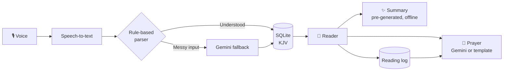

<div align="center">

# 🌅 Matins

### Open the Word by voice. Understand it in seconds. Pray it all day.

A morning-first Bible app built with **React Native**, **TypeScript** and **SQLite**.
Say the passage. Get the summary. Turn it into a prayer.

</div>

---

## 📖 Why Matins?

_Matins_ is the old word for **morning prayer**, and that is exactly the moment this app is built for.

Picture it. It is early, you are still half asleep, and someone calls out _"John 3:16"_. Now you are scrolling through 66 books, hunting for the right chapter while everyone else is already reading. After the reading, someone has to explain every verse out loud, and a quiet moment turns into a long one.

**Matins fixes that morning routine:**

| The problem                                       | The Matins answer                                                                        |
| ------------------------------------------------- | ---------------------------------------------------------------------------------------- |
| Hunting for a passage while half asleep           | 🎙️ **Voice search.** Say _"First Corinthians thirteen four to eight"_ and you are there. |
| Needing a quick explanation of what you just read | ✨ **AI chapter summaries**, short or detailed, ready instantly.                         |
| Prayer that feels disconnected from the reading   | 🙏 **Prayer generated from your passage**, based on what you actually read.              |
| No record of what you have been reading           | 📅 **Reading log** that tracks your activity and feeds your prayers.                     |
| Spotty data connection                            | 📴 **Offline-first.** The Bible and summaries live on your phone.                        |

---

## ✨ Features

### 🎙️ Voice search _(the headline feature)_

Speak a reference naturally and Matins opens it. A **rule-based parser** handles most requests instantly, with no internet and no API cost. AI is only a fallback for messy input.

| You say                                    | Matins opens            |
| ------------------------------------------ | ----------------------- |
| "John chapter three verse sixteen"         | John 3:16               |
| "First Corinthians thirteen four to eight" | 1 Corinthians 13:4–8    |
| "Psalm twenty three"                       | Psalms 23               |
| "Song of Songs two"                        | Song of Solomon 2       |
| "The one about the prodigal son"           | Luke 15 _(AI fallback)_ |

### ✨ AI summaries

All **1,189 chapters** are summarised once, ahead of time, and bundled into the app. That means summaries load instantly, work offline and cost nothing per user.

### 🙏 Morning prayer generator

Your reading and its summary become a short, personal prayer. When you are offline, a template-based fallback still gives you something meaningful.

### 📅 Reading activity

Every reading is logged with its passage, time and an optional note. That history shapes the prayers Matins writes for you.

### 🎨 Designed for early mornings

A warm paper-and-green palette, large readable verses set in **Source Serif 4**, and a big mic button where your thumb already is. A dark mode for dim rooms is planned.

---

## 🧠 How it works



**Design principles**

- **Offline first.** Reading, navigation, voice parsing and summaries need no internet.
- **Cheap AI.** Pre-generate what repeats (summaries). Call the API only for what is personal (prayers).
- **Fast when you are sleepy.** Common actions take one tap or one sentence.

---

## 🛠️ Tech stack

| Layer          | Choice                                                     |
| -------------- | ---------------------------------------------------------- |
| App            | React Native + TypeScript                                  |
| Local database | SQLite (on-device)                                         |
| Speech-to-text | On-device recogniser, online fallback                      |
| AI             | Google Gemini (summaries pre-generated, prayers on demand) |
| Bible text     | King James Version (public domain)                         |
| Typography     | Source Serif 4 and Inter                                   |
| Animation      | Reanimated + Skia (animated logo)                          |

---

## 🗄️ Data model

```sql
books(id, name, abbrev, testament, chapter_count)
verses(id, book_id, chapter, verse, text)
summaries(book_id, chapter, short, detailed)
readings(id, book_id, chapter, verse_start, verse_end, read_at, note)
prayers(id, reading_id, text, created_at)

CREATE INDEX idx_verses_ref ON verses(book_id, chapter, verse);
```

---

## 🚀 Getting started

> Replace the placeholders below with your real repo and commands.

```bash
# Clone
git clone https://github.com/<your-username>/matins.git
cd matins

# Install
npm install

# Run on Android
npm run android

# Or with Expo
npx expo start
```

**Environment**

```bash
# .env.local
EXPO_PUBLIC_PRAYER_API_URL=https://your-api.example.com/api/prayer
```

The app sends a `POST` request to this endpoint with `{ "reference": "Genesis 1", "translation": "KJV", "chapter": [{ "verse": 1, "text": "..." }] }`. Return `{ "prayer": "..." }`. Keep Gemini credentials on your backend; the mobile app only needs the public endpoint URL.

**Testing on a real device:** mirror your phone to your PC with [scrcpy](https://github.com/Genymobile/scrcpy). Judge performance on a **release build**, not a dev build.

---

## 📁 Project structure _(planned)_

```
matins/
├── src/
│   ├── components/      # Reader, VerseText, MicButton, SummaryCard
│   ├── screens/         # Reader, VoiceSearch, Insight, Log
│   ├── db/              # SQLite setup, queries, migrations
│   ├── voice/           # speech-to-text + reference parser (+ tests)
│   ├── ai/              # prompts for summaries and prayers
│   ├── theme/           # colours, fonts, spacing
│   └── animation/       # logo morph
├── assets/              # KJV data, bundled summaries, fonts
└── scripts/             # one-off summary generation
```

---

## 🗺️ Roadmap

- [x] Name, branding and first UI designs
- [ ] Import KJV into SQLite
- [ ] Reader screen (book, chapter, verses)
- [ ] Book and chapter picker
- [ ] Voice reference parser with full test suite
- [ ] Speech-to-text integration
- [ ] Pre-generate and bundle 1,189 chapter summaries
- [ ] Reading log
- [ ] Prayer generation (online and offline fallback)
- [ ] Animated logo (horizon → sunrise book → M)
- [ ] Dark mode
- [ ] Reading plans

---

## 🎨 Design

- **Palette:** deep green `#2F5D50` on warm paper `#FBF7F0`, with soft sun-gold `#F3D9A4`
- **Type:** Source Serif 4 for scripture, Inter for the interface
- **Logo:** a sun that rises over the horizon, opens into a book, then settles as the dot of an **M**. The M is the static app icon.

---

## 📜 Licence and text

- App code: add your chosen licence here (for example MIT).
- Bible text: the **King James Version** is in the public domain. Other translations would need their own licence.
- Matins is an independent project and is not affiliated with any other Bible app.

---

<div align="center">

**Built early in the morning, for early mornings.** 🌅

_"Thy word is a lamp unto my feet, and a light unto my path." — Psalm 119:105_

</div>
